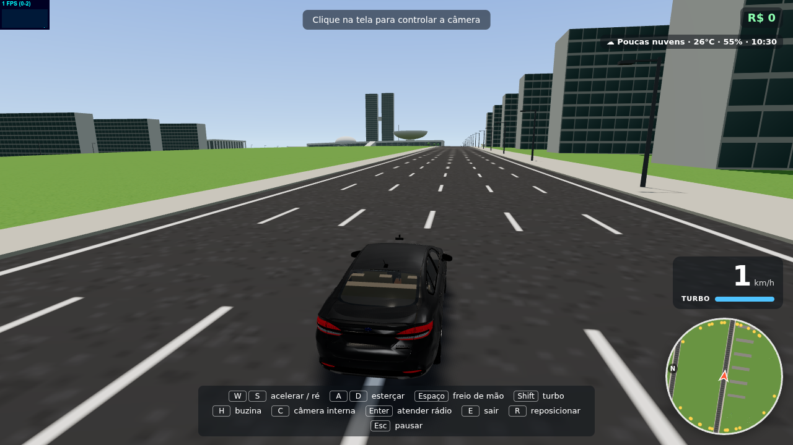
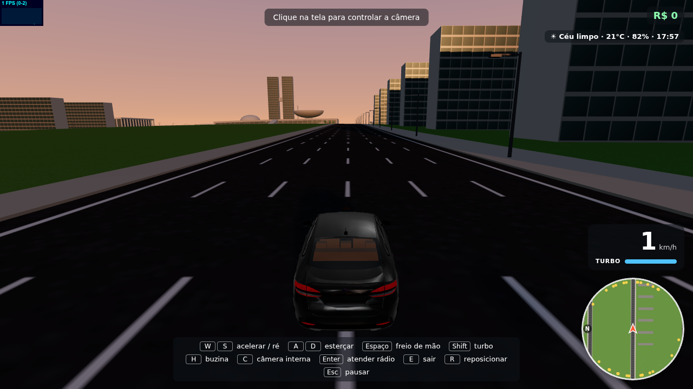
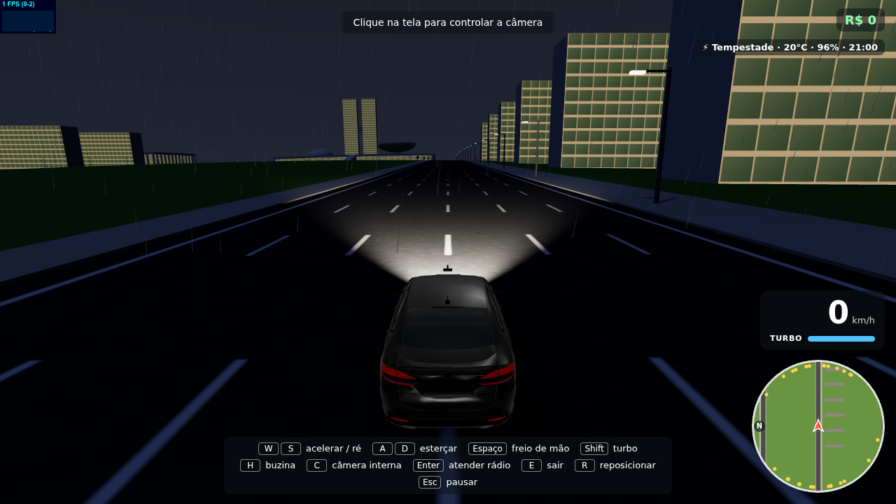
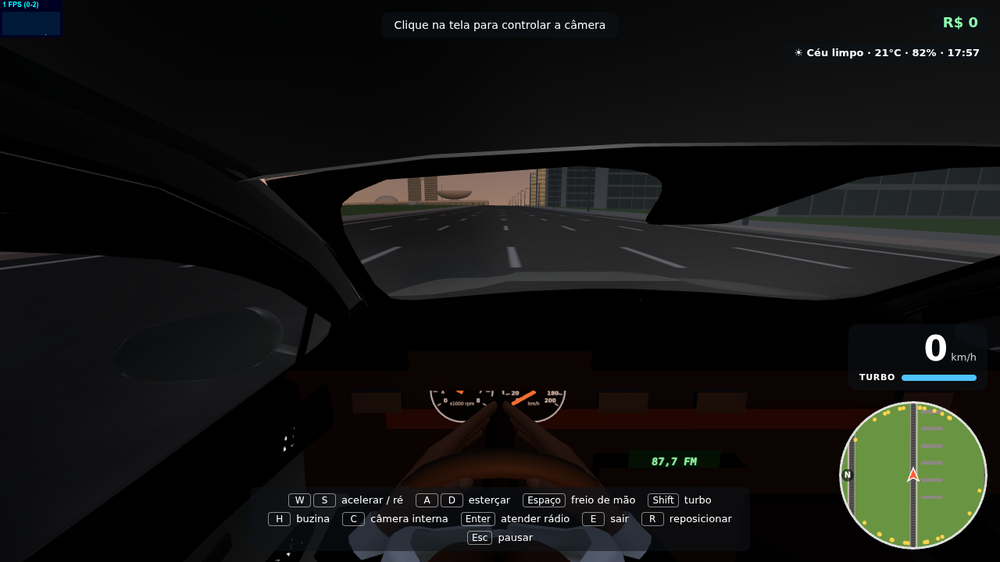

# Supremo Motorista

Jogo 3D de direção em terceira pessoa, no navegador e no desktop, ambientado numa **Brasília condensada**.
Você é **Josué**, motorista do fictício **Tribunal**, e leva ministros (igualmente fictícios) pela cidade no
estilo Crazy Taxi: chamado no rádio, pressa, saltos nas tesourinhas, derrapagens no Eixão e gorjeta conforme
o humor do passageiro. É uma sátira; ninguém real aparece no jogo.



| Entardecer | Tempestade à noite | Câmera interna |
|---|---|---|
|  |  |  |

## O que já dá para fazer

- Andar a pé (correr, pular) e dirigir cinco carros da frota oficial, cada um com física e som próprios.
- Atender corridas do "Rádio do Tribunal": buscar o passageiro, chegar dentro do tempo e receber diária,
  gorjeta, bônus por salto/derrapagem e multas por batidas, postes derrubados e mergulhos no lago.
- Explorar a cidade: Esplanada e Praça dos Três Poderes, Lago Paranoá com orla e Lago Sul, Eixão com
  tesourinhas e superquadras, Rodoviária e feira, aeroporto, Ponte JK e outros marcos.
- Fugir dos **Vermelhos** e dos **Amarelos**, facções fictícias que perseguem o carro oficial pelas ruas
  (com tomates) quando a polarização esquenta nos territórios deles.
- Atender ministros com manias próprias: o Orador que discursa no caminho, a Palestrante que exige paradas,
  o Novato medroso ou empolgado, a Presidente com pressa e o Discreto que não quer ser visto.
- Fazer (ou recusar) "favores" para o banqueiro **Dr. Rubens Caixeta**: pagam muito, mas enchem o
  **Medidor de Suspeição**, atraem a imprensa e podem virar manchete e multa da Corregedoria.
- Jogar a **campanha de 10 dias**, com capítulos de história, manchetes da Gazeta da Tesourinha e três
  finais (Motorista Exemplar, Sócio do Caixeta ou Demitido), com trilha de bossa nova e jazz.
- Fazer carreira: expedientes com meta diária, contracheque, advertências, a **Oficina do Tribunal** para
  melhorar a frota e comprar carros, e o progresso salvo automaticamente.
- Jogar com o **clima, a hora e os feriados reais de Brasília**: chuva molha a pista e tira aderência, a
  noite acende postes, janelas e faróis, feriado dobra a gorjeta. O relevo também é o real.
- Câmera interna com as mãos do motorista no volante, minimapa, controles de toque e versão desktop.

Detalhes de tudo que foi feito e do que falta: [docs/ROADMAP.md](docs/ROADMAP.md).

## Como rodar

Requisitos: Node.js 22 ou mais novo (desenvolvido no 24).

```bash
npm install
npm run dev          # http://localhost:5173 (com painel de debug lil-gui e stats.js)
npm run build        # checagem de tipos + build de produção em dist/
npm run preview      # serve o build de produção
```

### Desktop (Electron)

```bash
npm run desktop      # build + abre o jogo numa janela desktop
npm run dist:linux   # gera release/Supremo Motorista-<versão>.AppImage
npm run dist:win     # Windows (o instalador .exe precisa do Wine fora do Windows; o .zip sempre sai)
```

A versão desktop pede a GPU dedicada, libera WebGPU e tem opções próprias no menu de pausa (tela cheia,
FPS sem limite). Para depurar o build empacotado: `GAME_DEBUG=1` expõe `window.game` no console.

### Web (itch.io)

```bash
npm run dist:web     # gera release/Supremo Motorista-<versão>-web.zip (index.html na raiz)
```

O build usa caminhos relativos e roda em qualquer subpasta. No itch.io, crie um projeto do tipo *HTML*,
envie o zip marcado como *"This file will be played in the browser"* e ligue o botão de tela cheia.

### Outros scripts

```bash
npm run typecheck    # só o TypeScript
npm run terrain      # baixa de novo a elevação real (Open-Meteo) e regenera src/world/city/terrainData.ts
```

## Controles

| A pé | Dirigindo |
|---|---|
| **W A S D** mover | **W / S** acelerar / ré |
| **Shift** correr | **A / D** esterçar |
| **Espaço** pular | **Espaço** freio de mão (drift) |
| **E** entrar no carro | **Shift** turbo |
| **Enter** atender o rádio | **H** buzina · **C** câmera interna |
| **O** Oficina (na garagem) | **O** Oficina (parado na garagem) |
| **Mouse** câmera | **E** sair · **R** reposicionar |
| **Esc** pausar | **Enter** atender o rádio · **Esc** pausar |

No celular/tablet aparecem controles de toque.

## Regras de conteúdo

O jogo é uma sátira e segue estas regras (valem para qualquer contribuição):

- **Tudo é fictício:** nada de nomes reais de pessoas, partidos, bancos ou processos. O tribunal é "o
  Tribunal"; os grupos políticos são só **Vermelhos** e **Amarelos**; o banqueiro é o **Dr. Rubens Caixeta**, do
  **Banco Confiança S.A.**
- **Marcos e instituições reais** (Congresso, TST, PGR, Torre de TV…) podem aparecer com o nome real **só
  como cenário**: nunca em corridas, manchetes, falas ou piadas.
- **Violência só no pastelão.**
- **Textos sempre no i18n** (`src/data/i18n/`, pt-BR), nunca escritos direto no código.
- **Carros fictícios:** montadoras e modelos inventados ("Candanga Vereda", "Aurora Solene H"…), gerados em
  código (`src/vehicle/carDesign.ts`), sem copiar o desenho de carros reais nem usar marcas.

## Tecnologia

TypeScript (strict) + Vite, three.js puro, Rapier (física, `@dimforge/rapier3d-compat`), three-mesh-bvh
(raycasts da câmera e do piso), HUD em DOM, lil-gui e stats.js só em desenvolvimento, Electron +
electron-builder no desktop. Nenhum outro framework.

Como o código está organizado: [docs/ARQUITETURA.md](docs/ARQUITETURA.md).
Modelos, sons e dados externos (e como adicionar novos): [docs/ASSETS.md](docs/ASSETS.md).

## Estrutura

```
src/
  core/      loop do jogo (Game), input, configurações, i18n, utilidades
  world/     World (colisores, iluminação), Level, gerador da cidade em world/city/
  player/    Josué: física (cápsula), avatar, animações, motorista sentado com IK
  vehicle/   carro (Rapier raycast vehicle), visual, interior, efeitos
  rides/     sistema de corridas
  env/       clima, hora, feriados e o efeito deles (chuva, noite, pista molhada)
  audio/     sistema de som (Web Audio) e sons do carro, do jogador e do ambiente
  hud/       HUD, minimapa, menu de pausa, tela de carregamento, controles de toque
  data/      dados do jogo e textos (i18n)
electron/    processo principal do app desktop
scripts/     ferramentas de desenvolvimento (download do relevo)
tools/       conversor de modelos 3D (carros e personagem), usado fora do jogo
public/      modelos 3D e sons
docs/        documentação
```

## Créditos e licenças

Todos os modelos, sons e dados de terceiros, com autor, origem, licença e alterações feitas, estão em
[CREDITS.md](CREDITS.md). Os modelos de carro e o personagem são CC BY 4.0 (exigem crédito); os sons são
CC0, assim como as músicas; clima e relevo vêm do Open-Meteo (CC BY 4.0) e os feriados da BrasilAPI.

### Licença

| Parte | Licença |
|---|---|
| Código | [MIT](LICENSE): use, modifique e distribua à vontade, inclusive comercialmente |
| Textos e conteúdo criativo (`src/data/i18n/`, roteiro, imagens de divulgação) | [CC BY-NC-SA 4.0](LICENSE-CONTEUDO.md): livre para uso não comercial, com crédito |
| Nome "Supremo Motorista", logotipo e personagens | todos os direitos reservados ([detalhes](LICENSE-CONTEUDO.md)) |
| Modelos, sons e dados de terceiros | a licença de cada autor ([CREDITS.md](CREDITS.md)) |

Ou seja: o código pode ser reaproveitado em qualquer projeto, mas não dá para lançar uma cópia deste jogo
com o mesmo nome e conteúdo. Quer contribuir? Veja o [CONTRIBUTING.md](CONTRIBUTING.md).
